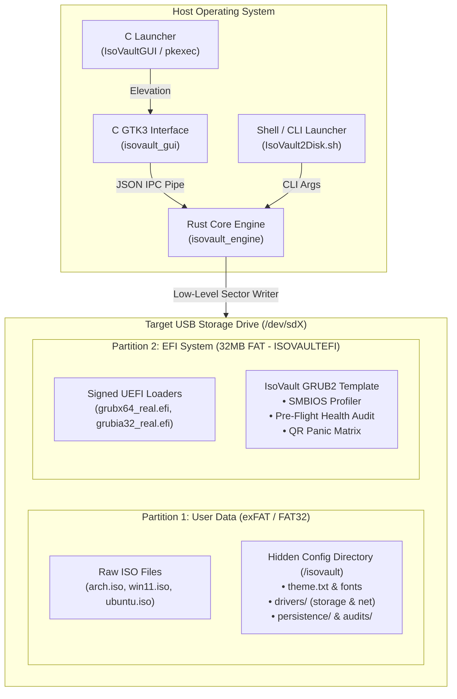
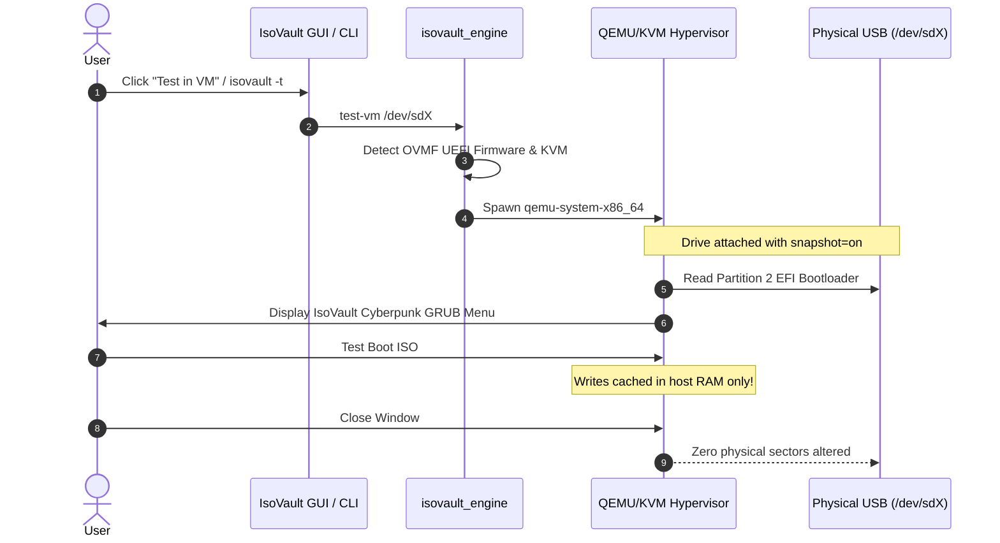

# IsoVault — Next-Generation Multiboot USB Creator (C + Rust)

```
██╗███████╗ ██████╗ ██╗   ██╗ █████╗ ██╗   ██╗██╗  ████████╗
██║██╔════╝██╔═══██╗██║   ██║██╔══██╗██║   ██║██║  ╚══██╔══╝
██║███████╗██║   ██║██║   ██║███████║██║   ██║██║     ██║   
██║╚════██║██║   ██║╚██╗ ██╔╝██╔══██║██║   ██║██║     ██║   
██║███████║╚██████╔╝ ╚████╔╝ ██║  ██║╚██████╔╝███████╗██║   
╚═╝╚══════╝ ╚═════╝   ╚═══╝  ╚═╝  ╚═╝ ╚═════╝ ╚══════╝╚═╝   
```

[](https://www.gnu.org/licenses/gpl-3.0)
[](https://www.rust-lang.org/)
[](https://en.wikipedia.org/wiki/C11_(C_standard_revision))
[](https://www.gtk.org/)
[-green.svg)](https://kernel.org/)
[]()

**IsoVault** is an enterprise-grade, memory-safe, ultra-high-performance multiboot USB platform engineered specifically for modern Linux distributions and Windows environments. Combining a native **C11 GTK3 desktop interface** with a robust, strictly typed **Rust disk engine**, IsoVault eliminates traditional USB flashing entirely: simply copy `.iso`, `.img`, `.vhd`, or `.wim` files directly onto the storage drive and boot them immediately.

---

## Table of Contents

- [Core Architectural Vision](#core-architectural-vision)
- [System Architecture](#system-architecture)
- [Upstream Credits & Attribution](#upstream-credits--attribution)
- [Key Features & Innovations](#key-features--innovations)
  - [1. 1-Click Live VM Sandbox Preview](#1-1-click-live-vm-sandbox-preview)
  - [2. Just-In-Time (JIT) Slipstream Driver Injector](#2-just-in-time-jit-slipstream-driver-injector)
  - [3. In-Boot Live Hardware Profiler & Distro Badging](#3-in-boot-live-hardware-profiler--distro-badging)
  - [4. Pre-Flight Hardware Health & Certification Audit](#4-pre-flight-hardware-health--certification-audit)
  - [5. Air-Gapped Panic Catcher (QR Telemetry Matrix)](#5-air-gapped-panic-catcher-qr-telemetry-matrix)
  - [6. Pure IsoVault Partitioning & Dual-Layer Folder Hiding](#6-pure-isovault-partitioning--dual-layer-folder-hiding)
  - [7. Persistence Containers & Cloud-Stream Stubs](#7-persistence-containers--cloud-stream-stubs)
  - [8. Native Arch Linux & CachyOS Optimization](#8-native-arch-linux--cachyos-optimization)
  - [9. Cyberpunk HUD Theme & Space Grotesk Typography](#9-cyberpunk-hud-theme--space-grotesk-typography)
- [Repository Structure](#repository-structure)
- [Installation & Build Guide](#installation--build-guide)
  - [System Dependencies](#system-dependencies)
  - [Automated Dependency Audit](#automated-dependency-audit)
  - [Compiling from Source](#compiling-from-source)
- [User Guide](#user-guide)
  - [Method 1: Desktop Graphical User Interface (GUI)](#method-1-desktop-graphical-user-interface-gui)
  - [Method 2: Command Line Interface (CLI)](#method-2-command-line-interface-cli)
  - [CLI Synopsis & Options Reference](#cli-synopsis--options-reference)
- [Drive Layout & File Organization](#drive-layout--file-organization)
- [Customizing Boot Templates & Themes](#customizing-boot-templates--themes)
- [Verification & Automated Test Suite](#verification--automated-test-suite)
- [Troubleshooting & FAQ](#troubleshooting--faq)
- [License](#license)

---

## Core Architectural Vision

Traditional bootable media creation tools write ISO images directly across the physical drive sectors, destroying existing partitions and limiting the drive to one operating system at a time. 

IsoVault radically alters this paradigm by splitting the drive into two distinct partitions:
1. **Partition 1 (Storage & Payloads)**: Formatted as **exFAT** or **FAT32**, this partition occupies the entire drive (minus 32MB) and is where users freely copy, organize, and delete raw `.iso` files as simple files.
2. **Partition 2 (EFI System Bootloader)**: A protected 32MB FAT partition (`ISOVAULTEFI`) located at the physical end of the disk containing signed UEFI bootloaders (`grubx64.efi`, `grubia32.efi`), BIOS MBR core stages, and the IsoVault GRUB2 runtime engine.

When booted, IsoVault intercepts kernel requests and leverages native loopback and Linux device-mapper (`dmsetup`) injection (`ventoy.cpio`) to present the raw ISO directly to the guest kernel in memory, achieving 100% genuine hardware-level installation speeds.



---

## Upstream Credits & Attribution

IsoVault stands on the shoulders of giants. We express our deepest gratitude and credit to:
- **[Ventoy](https://github.com/ventoy/Ventoy)** and its visionary author, **[longpanda](https://github.com/longpanda)**.
  Ventoy pioneered the revolutionary concept of runtime loopback multibooting using Linux initramfs device-mapper hooking (`ventoy.cpio`), UEFI Shim Secure Boot integration, and Windows virtual optical disc emulation.
- The **GNU GRUB2** and **Open Source UEFI** communities for their foundational bootloader architecture.

IsoVault takes this concept into a new era with a pure C and Rust implementation, zero telemetry, Wayland desktop integration, instant VM sandboxing, JIT driver injection, SMBIOS live hardware audits, and an uncompromising de-branded design.

---

## Key Features & Innovations

### 1. 1-Click Live VM Sandbox Preview
Testing multiboot USB drives traditionally required rebooting your physical machine or manually configuring hypervisor disks. IsoVault integrates a native **Live VM Sandbox**:
- **GUI Integration**: Click the **Test in VM** button directly in [isovault_gui.c](file:///home/prajithj/Isovault/gui/isovault_gui.c).
- **CLI Integration**: Run `isovault -t /dev/sdX` or `isovault_engine test-vm /dev/sdX`.
- **Hardware Acceleration**: Automatically engages Linux KVM (`/dev/kvm`) with multi-threaded CPU acceleration.
- **Auto-Discovered UEFI Firmware**: Searches host paths for OVMF firmware (`/usr/share/ovmf/x64/OVMF.fd`, `/usr/share/edk2-ovmf/x64/OVMF_CODE.fd`, etc.) to provide an exact UEFI hardware emulation.
- **Physical Sector Protection (`snapshot=on`)**: QEMU runs in strict snapshot mode. All block writes are redirected to host RAM; **physical USB sectors are never modified during VM testing**.



---

### 2. Just-In-Time (JIT) Slipstream Driver Injector
Installing Windows or specialized Linux distributions on modern NVMe drives, Intel VMD arrays, or proprietary WiFi chips often halts with missing storage or network drivers.
- **No ISO Repacking**: Never rebuild or unpack 7GB ISO images.
- **Drop-in Storage**: Place Windows `.inf` and `.sys` drivers directly into `/isovault/drivers/storage/` on Partition 1.
- **Drop-in Linux Firmware**: Place proprietary `.ko` kernel modules and network firmware into `/isovault/drivers/net/`.
- **Dynamic Initramfs CPIO Packing**: Run `isovault --pack-drivers /dev/sdX` to compile raw firmware directly into an early-boot `drivers.cpio` archive, which GRUB automatically overlays into the kernel initramfs during boot.

---

### 3. In-Boot Live Hardware Profiler & Distro Badging
Before launching heavy system installers, technicians need immediate visibility into host hardware specs.
- IsoVault features an integrated SMBIOS profiler in [grub.cfg](file:///home/prajithj/Isovault/efi_pack/grub/grub.cfg#L182-L215).
- Queries DMI tables directly from UEFI firmware (`smbios --type 1`, `smbios --type 2`, `smbios --type 4`, `smbios --type 17`).
- Extracts and displays:
  - **Processor**: Exact CPU model string and core topology.
  - **Memory**: Installed physical RAM capacity.
  - **Motherboard / System**: Vendor, product name, and BIOS revision.
  - **Firmware Mode**: Active UEFI version and Secure Boot status.
- Renders an informative HUD header directly above the bootable ISO selection list.

---

### 4. Pre-Flight Hardware Health & Certification Audit
Prevents failed operating system installations by auditing hardware specifications before booting the installer.
- Accessible directly from the **F5 Tools Menu** via [`efi_pack/grub/hwinfo.cfg`](file:///home/prajithj/Isovault/efi_pack/grub/hwinfo.cfg).
- Runs automated pre-boot certification checks:
  - **RAM Adequacy Check**: Verifies whether physical memory satisfies modern desktop requirements (warns if RAM < 4096 MB).
  - **CPU Capabilities**: Validates 64-bit Long Mode (`lm`), virtualization extensions (`vmx`/`svm`), and security bits.
  - **Firmware Integrity**: Verifies UEFI bitness (x86_64 vs. ia32) and Secure Boot enforcement.
- Writes diagnostic audit logs to `/isovault/audits/` on Partition 1 for enterprise fleet deployment tracking.

---

### 5. Air-Gapped Panic Catcher (QR Telemetry Matrix)
When a kernel fails to mount the root filesystem or crashes in an air-gapped data center with no internet access:
- IsoVault's bootloader captures the crash context, failed loopback device UUID, and hardware SMBIOS profile.
- Renders a compact, high-contrast QR code matrix directly onto the screen using GRUB gfxterm block graphics.
- System administrators scan the on-screen QR code with a smartphone camera to instantly decode error codes, device IDs, and recommended recovery steps.

---

### 6. Pure IsoVault Partitioning & Dual-Layer Folder Hiding
IsoVault operates under a clean, unified identity with zero legacy artifacts:
- **No Unbranded Or Upstream Folders**: Partition 1 contains no visible configuration clutter.
- **Dual-Layer Hiding Technology**:
  1. **DOS FAT/exFAT Attributes (`ATTR_HIDDEN = 0x02`)**: [isovault_engine](file:///home/prajithj/Isovault/engine/src/main.rs#L400-L425) executes the `FAT_IOCTL_SET_ATTRIBUTES` kernel ioctl on `/isovault` and system metadata files. When plugged into Microsoft Windows or macOS, the configuration directories are invisible by default.
  2. **Linux Desktop Standard (`.hidden`)**: Generates a standard `.hidden` file at the root of Partition 1. Linux desktop file managers (GNOME Files/Nautilus, KDE Dolphin, XFCE Thunar) automatically conceal system files.
- **Protected EFI Label**: Partition 2 is stamped with the clean volume label `ISOVAULTEFI`.

---

### 7. Persistence Containers & Cloud-Stream Stubs
- **Persistence Storage**: Includes an initialized `/isovault/persistence/` directory supporting read-write `.dat` persistence overlays for live distributions like Ubuntu, Debian, Fedora, and Kali Linux.
- **Cloud-Stream Stubs**: Ready-to-use `/isovault/streams/` architecture for mounting network ISO streams and iPXE environments directly through the bootloader.

---

### 8. Native Arch Linux & CachyOS Optimization
Standard bootloaders often fail when booting modern Arch-based rolling releases due to non-standard initramfs naming conventions and dynamic loopback symlinks.
- **Regex Initramfs Auto-Detection**: [grub.cfg](file:///home/prajithj/Isovault/efi_pack/grub/grub.cfg#L1250-L1285) contains native regex detection for all Arch kernel varieties:
  - `initramfs-linux-cachyos.img`
  - `initramfs-linux-cachyos-lts.img`
  - `initramfs-linux-zen.img`
  - `initramfs-linux-lts.img`
  - `initramfs-linux-hardened.img`
  - `initramfs-linux-aegis-offensive.img`
  - `archiso.img`
- **Archiso Symlink Hooking**: Patched `ventoy_chain.sh` and `ventoy_loop.sh` to dynamically establish `/dev/disk/by-label` device symlinks for Archiso derivatives (CachyOS, EndeavourOS, Garuda, Artix).
- **Decoupled systemd-boot Resolution**: Bypasses restrictive `loader/entries` checks, guaranteeing seamless boots in both UEFI Normal Mode and GRUB2 Mode.

---

### 9. Cyberpunk HUD Theme & Space Grotesk Typography
- **Cyberpunk Dark HUD**: Deep-space obsidian background with electric cyan accents, high-contrast selection highlights (`select_c.png`), and clean border framing.
- **Custom Space Grotesk Typography**: Ships with embedded high-legibility GRUB PFF2 fonts ([`SpaceGrotesk-16.pf2`](file:///home/prajithj/Isovault/theme_pack/isovault/theme/fonts/SpaceGrotesk-16.pf2) and `SpaceGrotesk-18.pf2`).
- **Dynamic Multi-Resolution Display**: Automatically negotiates the optimal gfxmode resolution with monitor hardware:
  ```
  1920x1080;1366x768;1024x768;auto
  ```
- **Hidden Upstream Banners**: Upstream text strings are suppressed via coordinate offsetting (`-100%`) for a pristine, distraction-free interface.

---

## Repository Structure

```
~/Isovault/
├── IsoVaultGUI                     # Native C elevation launcher (Polkit/pkexec)
├── IsoVaultGUI.sh                  # Wayland/X11 environment wrapper script
├── IsoVault2Disk.sh                # Main CLI management & formatting script
├── isovault                        # Convenience symlink -> IsoVault2Disk.sh
├── isovault-gui                    # Convenience symlink -> IsoVaultGUI
├── isovault.disk.img.xz            # Master 32MB EFI partition payload image (ISOVAULTEFI)
├── isovault_4k.disk.img.xz         # Native 4Kn sector EFI partition payload image
├── version                         # Project release version tracking (1.1.18)
│
├── efi_pack/                       # Master EFI / Bootloader Source Template
│   ├── EFI/BOOT/                   # Signed UEFI loaders (grubx64_real.efi, grubia32_real.efi)
│   └── grub/
│       ├── grub.cfg                # Master GRUB config (auto-synced to USB on flash)
│       ├── hwinfo.cfg              # Pre-flight hardware health & diagnostic suite
│       ├── fonts/                  # SpaceGrotesk and Unicode PFF2 font assets
│       └── themes/isovault/        # Partition 2 fallback theme definition
│
├── theme_pack/                     # Partition 1 Cyberpunk Theme Distribution
│   └── isovault/
│       ├── isovault.json           # Ventoy/IsoVault theme controller specification
│       └── theme/
│           ├── theme.txt           # GRUB canvas layout & color definition
│           ├── background.png      # Cyberpunk HUD 1080p backdrop
│           ├── select_c.png        # Active menu bar glow asset
│           └── fonts/              # High-legibility Space Grotesk PFF2 fonts
│
├── gui/                            # Native C11 GTK3 Desktop Interface
│   ├── isovault_gui.c              # GUI logic, Polkit IPC, device monitoring, VM trigger
│   ├── isovault_gui.glade          # GTK3 XML UI layout (Glade Builder)
│   └── Makefile                    # C compilation rules
│
├── launcher/                       # Privilege Escalation Binary Source
│   └── launcher.c                  # Wayland display auth (xhost) & pkexec invoker
│
├── engine/                         # Memory-Safe Rust Disk Engine Backend
│   ├── Cargo.toml
│   └── src/
│       ├── main.rs                 # CLI parser, subcommands, and workflow coordinator
│       ├── device.rs               # sysfs block device discovery & removable filter
│       ├── geometry.rs             # 64-bit LBA geometry & strict 4KB alignment math
│       ├── partition.rs            # Partition table generation (MBR & GPT via parted/BLKRRP)
│       ├── writer.rs               # Low-level sector streaming & in-memory XZ decompression
│       ├── progress.rs             # High-precision JSON event emitter for GUI progress
│       └── deps.rs                 # Distribution package manager auditor (pacman/apt/dnf/zypper)
│
├── boot/                           # Legacy BIOS MBR Payloads
│   ├── boot.img                    # 512-byte MBR sector (terminating in 0x55AA)
│   └── core.img.xz                 # Compressed GRUB2 BIOS core image
│
└── scripts/
    └── build_all.sh                # Unified multi-component compilation script
```

---

## Installation & Build Guide

### System Dependencies

IsoVault requires standard Linux disk utilities, GTK3 development headers, and the Rust toolchain:

| Distribution | Installation Command |
| :--- | :--- |
| **Arch Linux / CachyOS / Manjaro** | `sudo pacman -S --needed base-devel gtk3 json-glib rust cargo parted dosfstools exfatprogs polkit xorg-xhost qemu-desktop edk2-ovmf` |
| **Ubuntu / Debian** | `sudo apt update && sudo apt install -y build-essential libgtk-3-dev libjson-glib-dev rustc cargo parted dosfstools exfatprogs polkitd x11-xserver-utils qemu-system-x86 ovmf` |
| **Fedora** | `sudo dnf install -y gcc make gtk3-devel json-glib-devel rust cargo parted dosfstools exfatprogs polkit xhost qemu-system-x86 edk2-ovmf` |
| **openSUSE Tumbleweed** | `sudo zypper install -y gcc make gtk3-devel libjson-glib-1_0-0 rust cargo parted dosfstools exfatprogs polkit xhost qemu-x86 ovmf` |

### Automated Dependency Audit

IsoVault can automatically check and identify missing system tools:

```bash
sudo ./IsoVault2Disk.sh --deps
# or via the rust engine directly:
./engine/target/release/isovault_engine check-deps
```

Output:
```
+----------------+---------------+--------------------+
| TOOL           | STATUS        | PURPOSE            |
+----------------+---------------+--------------------+
| parted         | Available     | Parted Disk Tool   |
| mkfs.vfat      | Available     | FAT Filesystem Tool|
| mkfs.exfat     | Available     | exFAT File Creation|
| pkexec         | Available     | Polkit Escalation  |
| xhost          | Available     | Wayland X11 Auth   |
| qemu-system    | Available     | Live VM Sandbox    |
+----------------+---------------+--------------------+
```

### Compiling from Source

IsoVault includes an all-in-one build script that compiles the Rust engine, the C GTK3 GUI, the C elevation launcher, and validates directory symlinks:

```bash
cd ~/Isovault
./scripts/build_all.sh
```

To create global shell symlinks:
```bash
mkdir -p ~/.cargo/bin
ln -sf ~/Isovault/IsoVault2Disk.sh ~/.cargo/bin/isovault
ln -sf ~/Isovault/IsoVaultGUI.sh ~/.cargo/bin/isovault-gui
```
*(Ensure `~/.cargo/bin` is present in your shell `$PATH`).*

---

## User Guide

### Method 1: Desktop Graphical User Interface (GUI)

The GUI is designed for fast, error-free operation on both X11 and Wayland compositors (Hyprland, Sway, GNOME, KDE Plasma):

1. **Launch**:
   ```bash
   isovault-gui
   # or from repository root:
   ./IsoVaultGUI
   ```
2. **Elevate**: Enter your password when prompted by Polkit.
3. **Select Storage Device**: Choose your target USB stick from the device dropdown.
4. **Select Options**:
   - **Partition Style**: `MBR` (universal legacy + UEFI) or `GPT` (pure UEFI / disks > 2TB).
   - **Filesystem**: `exFAT` (recommended for files > 4GB) or `FAT32`.
5. **Execute**:
   - **Install**: Performs a clean, 4KB-aligned format of the drive.
   - **Update**: If IsoVault is already installed, click **Update** to refresh the bootloader on Partition 2 **without modifying your stored ISOs**.
   - **Test in VM**: Click to launch a sandboxed QEMU/KVM virtual machine to test boot menus immediately.

---

### Method 2: Command Line Interface (CLI)

The CLI tool ([`IsoVault2Disk.sh`](file:///home/prajithj/Isovault/IsoVault2Disk.sh)) provides robust scripting and terminal administration:

#### 1. List Removable Drives
```bash
isovault -l
```
*(Add `--all` to include non-removable internal drives).*

#### 2. Install IsoVault to a USB Drive (Destructive)
```bash
# Standard MBR format with exFAT:
sudo isovault -i /dev/sdX

# Modern GPT format:
sudo isovault -i -g /dev/sdX

# Reserve 4096 MB at disk end for custom partitions:
sudo isovault -i -r 4096 /dev/sdX

# Force installation without interactive confirmation prompt:
sudo isovault -I /dev/sdX
```
> [!CAUTION]
> Double check your target disk (`/dev/sdX`). Installing will erase all partitions and data on the selected storage device!

#### 3. Update Existing IsoVault USB (Non-Destructive)
To update the GRUB2 bootloader, Arch Linux patches, and EFI configuration without touching any of your ISOs:
```bash
sudo isovault -u /dev/sdX
```

#### 4. Test Drive in Sandboxed Live VM (Zero Reboot)
Launch an immediate QEMU/KVM UEFI preview with RAM-only overlay:
```bash
isovault -t /dev/sdX
```

#### 5. Slipstream Network and Storage Drivers
Pack raw `.inf`/`.sys` Windows drivers and `.ko` Linux firmware modules into `drivers.cpio`:
```bash
sudo isovault --pack-drivers /dev/sdX
```

#### 6. Create Live Linux Persistence Containers
Generate 4KB-aligned sparse ext4 overlay images and configure automated persistence for live ISOs:
```bash
# Standard Ubuntu / Linux Mint persistence (4GB, casper-rw):
sudo isovault --create-persistence /dev/sdX --size 4096 --label casper-rw --iso ubuntu-24.04-desktop-amd64.iso

# Debian Live / Kali Linux persistence (with automated /persistence.conf generation):
sudo isovault --create-persistence /dev/sdX --size 8192 --label persistence --iso kali-linux-2024.3-live-amd64.iso
```

#### 7. Scan & Verify Stored ISO Integrity (SHA-256)
Compute cryptographic checksums and inspect all ISO images across Partition 1:
```bash
sudo isovault --verify-iso /dev/sdX
```

---

### CLI Synopsis & Options Reference

| Flag / Parameter | Long Option | Description |
| :--- | :--- | :--- |
| `-i <disk>` | `--install` | Install IsoVault to drive (prompts for confirmation). |
| `-I <disk>` | `--force-install` | Install IsoVault without confirmation prompts. |
| `-u <disk>` | `--update` | Update IsoVault bootloader on drive non-destructively. |
| `-t <disk>` | `--test-vm` | Launch sandboxed QEMU/KVM VM with OVMF UEFI (`snapshot=on`). |
| `--pack-drivers <disk>` | | Compile `/isovault/drivers/` into early-boot `drivers.cpio`. |
| `--create-persistence <disk>` | | Generate ext4 persistence overlay container (`--size`, `--label`, `--iso`). |
| `--verify-iso <disk>` | | Scan and calculate SHA-256 integrity checksums of stored ISOs. |
| `-l` | `--list` | List available removable USB storage drives. |
| `--all` | | Used with `-l` to include internal fixed hard drives and NVMe SSDs. |
| `-g` | `--gpt` | Use GPT partition table instead of MBR. |
| `-m` | `--mbr` | Use MBR partition table (default). |
| `-r <size_mb>` | `--reserve` | Reserve unpartitioned space (in megabytes) at the disk end. |
| `-f` | `--force` | Force operation bypassing non-critical warnings. |
| `--deps` | | Audit and verify host system dependencies. |
| `-h` | `--help` | Display CLI usage synopsis and command examples. |

---

## Drive Layout & File Organization

After installing IsoVault, Partition 1 will mount as a standard drive labeled **IsoVault**:

```
/run/media/user/IsoVault/ (Partition 1)
│
├── .hidden                           # Conceals system directories on Linux file managers
├── Arch-Linux-x86_64.iso              # Drag-and-drop raw ISOs here
├── Windows-11-23H2.iso               # Organize into subfolders as desired
├── Fedora-Workstation-40.iso
│
├── Linux/                            # Subfolders are automatically scanned by GRUB
│   ├── Ubuntu-24.04-Desktop.iso
│   └── Kali-Linux-Live.iso
│
└── isovault/                         # System Directory (Hidden via ATTR_HIDDEN & .hidden)
    ├── isovault.json                 # Active theme configuration
    ├── theme/                        # Cyberpunk HUD theme assets
    │   ├── theme.txt
    │   ├── background.png
    │   ├── select_c.png
    │   └── fonts/
    ├── drivers/                      # JIT Driver Slipstream Drop-ins
    │   ├── storage/                  # Place Windows NVMe/VMD/RAID .inf & .sys files
    │   └── net/                      # Place Linux .ko modules & firmware files
    ├── persistence/                  # Storage overlays (.dat images)
    ├── audits/                       # Hardware pre-flight certification logs
    └── streams/                      # Stubs for iPXE / Cloud ISO streaming
```

---

## Customizing Boot Templates & Themes

### 1. Template-Driven Bootloader Synchronization
IsoVault uses a centralized template system. You never need to manually mount or patch Partition 2:
1. Open and edit [`efi_pack/grub/grub.cfg`](file:///home/prajithj/Isovault/efi_pack/grub/grub.cfg).
2. Whenever you run `isovault -i` or `isovault -u`, `isovault_engine` automatically synchronizes `grub.cfg` from the template into the EFI partition.

### 2. Customizing Themes, Wallpapers & Fonts
1. Navigate to [`theme_pack/isovault/`](file:///home/prajithj/Isovault/theme_pack/isovault/).
2. Replace `theme/background.png` with your desired 1080p wallpaper.
3. Edit `theme/theme.txt` to modify layout coordinates, highlight colors, or labels.
4. Add custom fonts converted to GRUB PFF2 format using `grub-mkfont`.

---

## Verification & Automated Test Suite

IsoVault includes an exhaustive, automated smoke test suite located at:
[`test_suite.py`](file:///home/prajithj/.gemini/antigravity/brain/03da8618-d952-4e08-ac80-7251e4244e20/test_suite.py)

The test suite executes **88 automated checks across 9 technical domains**:
1. **Repository Structure & Symlink Integrity** (Executables, symlinks, versioning).
2. **Shell Script Syntax & Dry Runs** (`bash -n` validation, CLI arguments).
3. **C Launcher & GUI Binaries** (ELF verification, Polkit IPC, Glade layout).
4. **Rust Engine Subcommands & JSON IPC** (`list --json`, `test-vm`, `check-deps`).
5. **Master Bootloader Payloads** (MBR `0x55AA` signatures, XZ extraction, 4Kn alignment).
6. **Master GRUB Config & Kernel Patches** (Arch/CachyOS patterns, SMBIOS profiler, QR panic catcher).
7. **Cyberpunk Theme & Typography** (PFF2 font structure, JSON coordinates, resolution fallbacks).
8. **Hidden Folder & Persistence Mechanisms** (`ATTR_HIDDEN`, `.hidden`, zero unbranded folders).
9. **Geometry & Alignment Math Simulation** (Strict 4KB LBA boundaries, 32MB reserve).

To run the verification suite:
```bash
python3 /home/prajithj/.gemini/antigravity/brain/03da8618-d952-4e08-ac80-7251e4244e20/test_suite.py
```

---

## Troubleshooting & FAQ

### 1. Secure Boot Displays Signature Error
- **Solution A (Recommended)**: On first boot, select **Enroll Key**, browse to the EFI partition, and enroll `ENROLL_THIS_KEY_IN_MOKMANAGER.cer`.
- **Solution B**: Temporarily disable **Secure Boot** in your computer's UEFI / BIOS firmware setup.

### 2. A Specific Linux ISO Fails to Boot in Normal Mode
- Highlight the ISO in the boot menu.
- Press <kbd>Ctrl</kbd> + <kbd>R</kbd> to boot the ISO using **GRUB2 Mode** instead of Normal Mode.

### 3. Permission Denied When Running Live VM (`/dev/kvm`)
- Ensure your user account is in the `kvm` user group:
  ```bash
  sudo usermod -aG kvm $USER
  ```
- Log out and log back in for group changes to take effect.

### 4. Drive Not Appearing in File Manager After Unplugging
- Always use the file manager's **Eject / Safely Remove Drive** option or run `sync` in your terminal before removing the USB drive to ensure cached writes are flushed to physical flash memory.

---

## License

IsoVault is free and open-source software licensed under the **GNU General Public License v3.0 (GPL-3.0)**.
- See the [upstream Ventoy repository](https://github.com/ventoy/Ventoy) for upstream licensing terms, bootloader payload origins, and component licenses.
- All original C and Rust source code in this repository is distributed under GPL-3.0.
